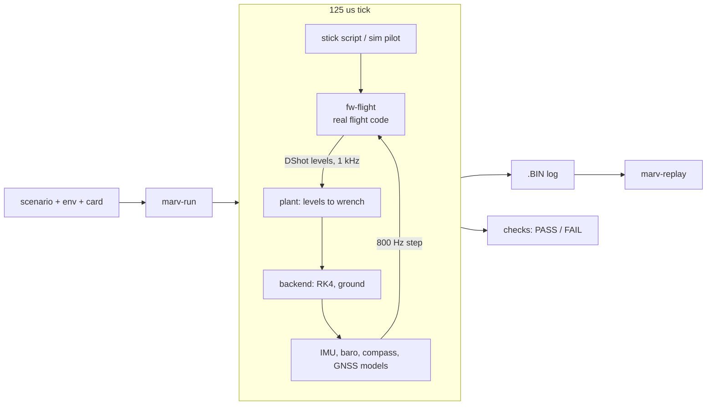

# MARV-sim

Simulator for the MARV V2 quadcopter. It runs the firmware's real flight code (`fw-core` and `fw-flight`, the same
crates the board runs on core 1) against a vehicle model, so a change to the flight code can be flown, judged and
compared without hardware. Runs are scripted by scenario files, judged by checks, and logged in the board's own `.BIN`
format.



## Needs the firmware next to it

`marv-sim/Cargo.toml` takes the firmware by path, so the firmware repository
([MARV-FC](https://github.com/Lmx154/MARV-FC)) must be checked out as a sibling directory named `MARV-V2-firmware`:

```toml
fw-flight = { path = "../../MARV-V2-firmware/crates/fw-flight", features = ["sim-fault", "sim"] }
fw-core   = { path = "../../MARV-V2-firmware/crates/fw-core" }
```

An edit to the flight code runs in the sim at once. `marv-sim/build.rs` reads the same checkout's git state and
records its commit (with `-dirty` if there are uncommitted changes) in every log. The firmware in turn pins `marv-card`
from this repo by git revision; the workspace `Cargo.toml` patches that pin to the local `marv-card/` folder so a build
holds one copy of the card crate.

## Quick start

```
cargo run -q --release -p marv-sim --bin marv-run -- --card marv-card/marv.toml --env env/default.toml \
    --scenario scenarios/hover.toml --seed 1 --out logs/hover-seed1.BIN
```

It prints a summary, one `CHECK` line per check, and a last line `RESULT: PASS` or `RESULT: FAIL`. Exit status 0 means
every check passed, 3 a check failed, 1 a load or run error, 2 a usage error. Tests: `cargo test --workspace`.

## Index

| Page | In one line |
|---|---|
| [architecture](docs/architecture.md) | The loop, its rates and what runs where |
| [vehicle-model](docs/vehicle-model.md) | The vehicle card, the environment, the plant, the ground and the drag |
| [sensors](docs/sensors.md) | IMU, barometer, compass and GNSS models |
| [scenarios](docs/scenarios.md) | Scenario file, stick scripts, phases and the sim pilot, verdict checks |
| [campaigns](docs/campaigns.md) | Parameter spread, run matrix, fault, hands-off and mission scenario sets |
| [estimators](docs/estimators.md) | `--estimator`, `--shadow`, `--preroll` |
| [tools](docs/tools.md) | `marv-run`, `marv-replay`, `card-check`, the log, tests |
| [gazebo](docs/gazebo.md) | The Gazebo model and world generated from the card |

| Folder | Contents |
|---|---|
| [marv-sim](marv-sim/README.md) | The simulator crate: library, `marv-run`, `marv-replay`, tests |
| [marv-card](marv-card/README.md) | The vehicle card, its checker and the compiled constants for the firmware |
| [env](env/README.md) | The environment file |
| [scenarios](scenarios/README.md) | Scenario and spread files |
| [gz](gz/README.md) | Gazebo model, world and generator |

## Status

Works: the card and its checker, the plant and ground contact, the IMU, barometer, compass and GNSS models, the
scenario runner with pilot, spread and matrix runs, the `.BIN` log, log replay through the estimators, shadow and
steering estimators, the hands-off and mission scenario sets. Tested on the host (`cargo test --workspace`); the
simulator is not flight hardware. Not built: wind gusts, logging of the slow-sensor samples, a TCP link. The Gazebo
model is generated and viewable; the sim does not drive it.

## MARV project

| Repository | Role |
|---|---|
| [MARV-FC](https://github.com/Lmx154/MARV-FC) | Flight-controller firmware for the MARV V2 board (RP2350B) |
| [MARV-GCS](https://github.com/Lmx154/MARV-GCS) | Ground station (`marv-gcs`) and command line (`marv-cli`) |
| **MARV-sim** | Simulator that runs the firmware's flight code |
| Sensors | [icm45686](https://github.com/Lmx154/icm45686-rs) · [lsm6dsk320x](https://github.com/Lmx154/lsm6dsk320x-rs) · [bmp581](https://github.com/Lmx154/bmp581-rs) · [bmm350](https://github.com/Lmx154/bmm350-rs) · [sam-m10q](https://github.com/Lmx154/sam-m10q) · [adc-battery](https://github.com/Lmx154/adc-battery) |
| Board I/O | [pio-sdmmc](https://github.com/Lmx154/pio-sdmmc-rs) · [qmi-psram](https://github.com/Lmx154/qmi-psram-rs) · [ws2812c](https://github.com/Lmx154/ws2812c-rs) · [usb-cdc](https://github.com/Lmx154/usb-cdc) · [pio-uart](https://github.com/Lmx154/pio-uart) |
| Motors and links | [dshot](https://github.com/Lmx154/dshot-rs) · [esc-passthrough](https://github.com/Lmx154/esc-passthrough) · [rc-port](https://github.com/Lmx154/rc-port) · [crsf-codec](https://github.com/Lmx154/crsf-codec) · [mavlink-device](https://github.com/Lmx154/mavlink-device) · [marv-dialect](https://github.com/Lmx154/marv-dialect) |
| Other drivers | [lc76g](https://github.com/Lmx154/lc76g-rs) (Quectel LC76G GNSS) |

## Licence

MIT (see `license` in the crate manifests).
