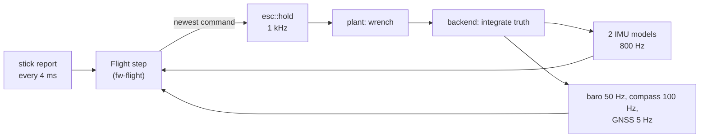

# Architecture

Part of [MARV-sim](../README.md)

The simulator is one single-threaded loop on a 125 us base tick. It feeds the firmware's `Flight` step the same inputs the board
gives it (IMU samples, slow-sensor samples, stick reports, ESC state) and applies the motor levels it returns to a plant.
Nothing in the flight path is re-implemented: the flight step, the gate, the allocator, `Tuning::DEFAULT` and the compiled
card constants are the firmware's.

## Rates

| Every | Rate | What happens |
|---|---|---|
| 1 tick (125 us) | 8 kHz | The plant makes a wrench (plus any disturbance torque), the backend integrates it, the slow sensors record the truth |
| 8 ticks | 1 kHz | The plant takes `fw_flight::esc::hold(..).throttles()` of the newest flight command (the board's stale-command rule: 0 for Stop) |
| 10 ticks | 800 Hz | Both IMU models sample; the flight step runs once, with each waiting slow sample once (`Sensors.baro`, `mag`, `gnss`; `None` when none is new) |
| 32 ticks (4 ms) | 250 Hz | A stick report is made from the script row in force, unless the link is lost; the newest goes to the next flight step, once |
| 80 ticks | 100 Hz | Compass sample |
| 160 ticks | 50 Hz | Barometer sample |
| 1600 ticks | 5 Hz | GNSS sample (8000 or 800 ticks at 1 or 10 Hz, by `gnss_rate_hz`) |

With `rc_source = "receiver"` reports are receiver reports at 100/s (every 10 ms) instead of CRSF at 250/s; the pilot still makes
one every 4 ms and the newest is sent.

## What the sim supplies in place of the board

| Board | Sim |
|---|---|
| Core 0 arming permit (pre-arm rule) | The runner sets the permit once, before the first flight step; boot is not modelled |
| Slow-sensor path | Each slow model's newest sample, once per flight step |
| Radio heartbeat, battery | Fed directly to `Flight` by the runner (hands-off and mission scenarios) |
| Sensor hardware | Seeded models, see [sensors](sensors.md) |

## Determinism

The same card, environment, scenario, point and seed give a byte-identical log. Each noise source has its own stream
(IMUs 1 and 2, then 3 barometer, 4 compass, 5 GNSS, 6 GNSS velocity, 7 barometer motion error), so adding a model does not change
the others.

## Code

| Path | Role |
|---|---|
| `marv-sim/src/bin/marv-run.rs` | The loop and the runner |
| `marv-sim/src/plant.rs`, `backend.rs` | Wrench and truth |
| `marv-sim/src/sensors.rs`, `slow_sensors.rs`, `rng.rs` | Sensor models, noise |
| `marv-sim/src/pilot.rs`, `scenario.rs`, `verdict.rs` | Stick sources, scenario files, checks |

## Related

[vehicle-model](vehicle-model.md), [sensors](sensors.md), [scenarios](scenarios.md), [tools](tools.md)
