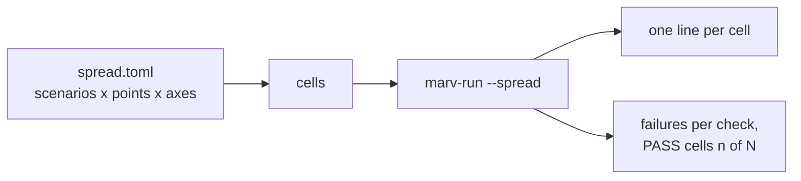

# Campaigns

Part of [MARV-sim](../README.md)

A campaign is many runs of one or more scenarios over a grid of plant points, air, ground and seeds. A spread file describes the
grid; `marv-run --spread` runs it and reports PASS only if every cell passes. The scenario sets under `scenarios/` are campaigns
that were built this way for hands-off, heading-monitor and mission behaviour of the firmware.



## Spread and matrix

```
marv-run --card marv-card/marv.toml --env env/default.toml --spread scenarios/spread.toml --seed 1 --out-dir logs/spread
```

`scenarios/spread.toml` runs the five basic scenarios at five points: nominal; k_F x0.7 or x1.3 with the inertia x1.25 or x0.75,
each with both motor time constants 0.060 or 0.030 s. Only the plant and backend take a point; the flight code keeps the compiled
card. `--point "<kf_scale>,<inertia_scale>,<lag_s or ->"` runs one point (`-` keeps the card's time constants).

A spread file is a matrix: `scenarios`, `points` (required) and axes `maps`, `air`, `ground`, `seeds`. A missing axis has one
default that changes nothing. A missing `seeds` means `--seed` is the one seed; `--seed` is a usage error (exit 2) when the file
has `seeds`. `scenarios/takeoff-land-matrix.toml` is `takeoff-land` at 5 points x 2 maps x 3 air x 3 ground x 3 seeds = 270 cells.

| Axis | Key | Values |
|---|---|---|
| map | `speed_at_level_min` (plant only) | A: card (94.8); B: 128.9 rad/s |
| air | `drag` N/(m/s), `wind_ned` m/s | 1: drag 0, calm; 2: drag 0.407, calm; 3: drag 0.407, wind [0, 2, 0] |
| ground | `imu1_gyro_bias_rads`, `imu1_accel_bias_ms2`, `roll_pitch_deg` | 1: level; 2: IMU1 bias corner; 3: 5 deg roll slope |

Axis values change only the plant, environment and sensors, never the flight code or the pilot's stick map.

A cell is named `p<point>-map<letter>-air<n>-gnd<n>-seed<s>` (with `<scenario>-` in front when the file has several scenarios), for
example `p2-mapB-air3-gnd2-seed1`. Output: one line per cell, failures per check, `PASS cells n of N`, counts per ground and air
case, the wall time (about 20 s for 270 cells) and `RESULT`.

| Option | Effect |
|---|---|
| `--only <cell>` | Run that cell alone, print its summary and checks, write its log (a rerun is byte-identical) |
| `--logs fail\|all` | Keep `<out-dir>/<cell>.BIN` only for failing cells (default; about 11 MB each for `takeoff-land`) or all |

Range refusal: before any run every cell is checked against the card's numeric range of each number it changes (k_F and inertia
scale `range_pct`, `lag_s`, `speed_at_level_min`, `drag.rotor_linear`, the IMU1 biases, the wind). A cell outside is refused, exit 1,
naming the cell and the range. A number whose range is `"ask"` has no numeric range. A slope on a scenario that does not start on
the ground is refused too.

The bias corner (`gnd2`): gyro = w + b_g and accel = [b_ax, b_ay, -g] at rest, with accel +0.1961 on x and y, gyro x -6.981e-3 and
gyro y +6.981e-3 (rad/s); the tilt errors add on x when b_ax and b_gy share a sign and on y when b_ay and b_gx have opposite signs.

## Scenario sets in scenarios/

| Folder | Content |
|---|---|
| `fault/` | Diagnostic runs with injected faults: GNSS lost or held, compass rotated or stuck, latency, pitch shuttle, yaw turn; not in the spread |
| `headmon/` | Heading-monitor runs: filter yaw turned by 30 to 90 deg using the firmware's `sim-fault` hook (`yaw_inject`); run with `--estimator eskf3 --preroll 60` |
| `handsoff/`, `handsoff-n/`, `handsoff-n2/` | Hands-off behaviour after the stick reports stop: HOLD, LAND, the 5 m track fault; stick-loss descent |
| `mission/`, `mission-p3/`, `mission-r/` | Waypoint missions: AUTO, RETURN, pause, resume, battery and heartbeat conditions |
| `negative/` | Negative controls that must FAIL |
| `ms-smoke/` | Mission-switch smoke scenarios, see its [README](../scenarios/ms-smoke/README.md) |

A campaign run writes its per-cell figures (`summary.txt`, `results*.txt`) into its folder; they are not committed. A cell in these sets is a
scenario at a plant point, air case and seed; typical flags are `--estimator eskf3 --fs-hold --pilot-speed 3.0 --preroll 60`.

## Hands-off and mission flags

| Flag or field | Effect |
|---|---|
| `--fs-hold` | `FS_HOLD_EN` 1 before arming; radio HEARTBEAT time given fresh at every flight step unless `--no-heartbeat`; `heading_ok` after every step as the estimator's heading flag; prints a `hands_off` line |
| `--ho` | The `hands_off` line without `--fs-hold` (`FS_HOLD_EN` 0, no HEARTBEAT) |
| `--no-heartbeat` | Do not feed the heartbeat |
| `--x-inf` | Control: the track distance forgotten after every step (`Flight::sim_clear_track_error`) so the 5 m rule cannot trip |
| `--pilot-speed <m/s>` | `PILOT_SPEED_XY` before arming |
| `--ground-s <s>` | Replaces the `after_s` of a pilot scenario's first (ground, disarmed) phase |
| `--gdn <n>,<e>` (repeat up to 4), `--gdn-radius <m>` | Run the firmware's shadow guidance with targets as offsets from the estimator origin; one `GDN` record every 8th step and one `gdn` line |
| `mission = [{ at_s, radius_m, return_h, waypoints }]` | Mission list uploaded at `at_s` |
| `commands = [{ after_hold_s, cmd }]`, `resume = { after_done_s }` | Commands (for example `"start"`) and the reports resuming after the mission |
| `station_hb`, `radio_status` | Windows in which the station heartbeat and RADIO_STATUS are fed |
| `[scenario] thrust_gain = { from_s, to_s, from, to }` | Scale on all four rotors' thrust and reaction torque: `from` until `from_s`, linear to `to` at `to_s` |
| `[scenario] push = { from_s, to_s, north_n, east_n }` | Horizontal world-frame force (N) added to the plant's wrench |
| `MARV_MS_CSV=<dir>` | Environment: one CSV per run (every 8th flight step and every state change: state, mode, leg, armed, motors running, truth position and velocity) |

Hands-off and mission cells give the simulator-side battery model the board's path (`fw_core::battery::Monitor` at 10 Hz).

## Related

[scenarios](scenarios.md), [estimators](estimators.md), [tools](tools.md), [scenarios folder](../scenarios/README.md)
