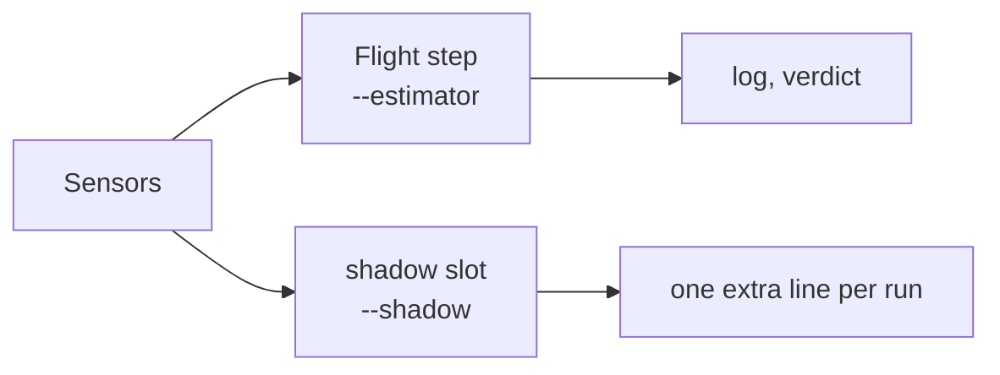

# Estimators

Part of [MARV-sim](../README.md)

By default the flight step runs the firmware's `Mahony` attitude filter. Options on `marv-run` swap in the firmware's other
estimators, or run one beside it in a shadow slot and report how well it tracks truth. All options below apply to both forms of
`marv-run` (single scenario and spread).

## --estimator

`--estimator mahony|eskf1|eskf2|eskf3` puts that estimator in the flight step (default Mahony). It adds one `steer <estimator>`
line per run (per cell in a spread).

| Value | What it is |
|---|---|
| `mahony` | The default |
| `eskf1` | `Eskf` with `Aiding::Imu`, built with `Eskf::with_aiding`; its own rates (PT1 minus bias) go to the rate loop |
| `eskf2` | As eskf1 with `Aiding::ImuBaro` (the GPS-less steering used by `alt-hold`) |
| `eskf3` | `SteerMix`: an `EskfSteer` around its own `Eskf::new` core for attitude, rates and the horizontal state, plus an `EskfZ` (`Aiding::ImuBaro`) for the vertical |

The `steer` line reports tilt error against truth (rms and max, first 5 s after the estimator's tilt is valid and after), the
largest gyro bias estimate, `motor_dlevel_rms`, `Eskf` re-initialisations, and `takeoff_rms_deg`, `takeoff_max_deg`, `takeoff_n`
(first armed step to 3 s after first lift-off). With a pilot scenario each touchdown adds a `TD` note. For eskf3 the line adds, after
a `|`, the output predictor's tracking error, `skipped`, `ring_dropped`, yaw alignment counts and times, `gps_pos_fused`,
`reinits`, the latch (`latch`, `latch_s`), tilt error over the run and after the first yaw alignment, heading error while `heading`
is valid and horizontal position error while `position_ne` is valid. `--window <from_s>,<to_s>` (repeatable, scenario time) adds a
`window` line per interval.

## --shadow

| Value | Runs | One line per run |
|---|---|---|
| `mahony-baro` | `MahonyBaro` (Mahony plus the vertical filter `VertKf`) after each flight step, with the same `Sensors` and armed state | `shadow mahony-baro`: `init_s`, D and vD error rms and max, `v_3sigma`, final `bd`, barometer `gated`/`fused`, `resets`, `identity_breaks` (steps differing from the flight step's Mahony bit for bit), pre-touchdown figures |
| `eskf` | The 15-state `Eskf`, declination from the env's field; its state refers to the horizon (`NavState.t_us`, 0.43 s behind), so it is compared with the truth of that step | `shadow eskf`: heading (`hdg_valid_s`, `hdg_bad15_s`, `hdg_worst_deg`), north-east (`ne_valid_s`, `ne_out3_s`, `ne_p_rms`), vertical as above, tilt against Mahony's on the same steps, counts (`mag_refused`, `screens`, `gated`, resets), `yaw_aligned`, `multi_job` |

The flight step still runs `Mahony`; the log, the verdict and every other output line are the same with and without the flag.
The barometer drift cannot be seen by the filter, so the height figure `d_max_nodrift` (with the model's drift taken out) is what is
judged against 0.3 m; the raw `d_max` is printed, not judged. Vertical speed is judged as `v_3sigma_pre_td` = 0, up to the
first touchdown, because the plant stops the vehicle in one tick at touchdown and no IMU sample shows it.

## --preroll

`--preroll <seconds>` steps the flight code (and the shadow) for that long before scenario time 0, disarmed, with the plant pinned
at the initial state (attitude and position as given, velocity and rates 0, rotors at their initial speed; the plant is not
stepped), so the sensor models see a vehicle at rest with their noise running. Air-start scenarios with a script only: a ground
start, a pilot scenario, or a non-zero initial velocity or rate is a usage error. Scenario time is unchanged: the pre-roll rows are
not logged (a `MSG` record says so) and the flight code's clock is scenario time plus the pre-roll. It does not model air-start
arming or a ground alignment; the take-off matrix covers alignment and the take-off transition.

## Other flight-step options

| Option | Effect |
|---|---|
| `--noaid-sigma <m>` | Replaces `Tuning::nav_noaid_sigma_m` (armed no-aid position hold) for every estimator |
| `--params <file>` | The ground station's parameter file (`NAME,VALUE` per line, `#` comments); its 14 `ATC_*` gains reach the flight step, the rest are defaults |
| `--tuning-override <name>=<value>` | Replaces one tuning value (negative controls, for example `psc_velz_i=0`) |
| `--notch` | Switches on the flight step's RPM notch before arming (motor poles 14) |

## Tests

`marv-sim/tests/nav_vertical.rs`: bit identity of `MahonyBaro` with Mahony (negative control included), accelerometer-bias
estimation, barometer latency compensated, and the scenario suite and both spread files through `--shadow mahony-baro` (295
flights; run with `--release`). `marv-sim/tests/nav_eskf.rs`: heading never valid while more than 15 deg wrong (negative
control a compass turned 30 deg), no alignment or GNSS before a disturbed take-off, north-east within 3 sigma with the GNSS latency
0.43 s (negative control delay 0), and the suite through `--shadow eskf`.

## Related

[sensors](sensors.md), [scenarios](scenarios.md), [tools](tools.md)
