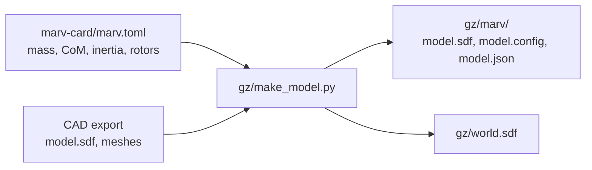

# Gazebo

Part of [MARV-sim](../README.md)

`gz/` holds a Gazebo model and world of the MARV quadcopter, generated from the vehicle card and the CAD export. It is for viewing
the vehicle; the sim's own loop does not drive Gazebo.



## Generate

```
python3 gz/make_model.py --card marv-card/marv.toml --cad <path to the CAD drone folder>
```

The CAD folder provides `model/marv_quad/{model.sdf,meshes/}`: meshes, link offsets and collision shapes. The generator writes
`gz/marv/{model.sdf,model.config,model.json}` and `gz/world.sdf`; the same inputs give byte-identical output. Meshes are referenced by
relative path, not copied. `model.json` records the CAD commit, the card sha256 and `h_rest`, the height at which the vehicle's
stance rests on the ground plane.

## View

```
GZ_SIM_RESOURCE_PATH=$PWD/gz gz sim -r --force-version 8.15.0 gz/world.sdf
```

## World

| Property | Value |
|---|---|
| Gravity | Zero, on purpose: the sim's plant applies the weight at the centre of mass |
| Start | z = `h_rest` (in `model.json`), stance on the ground plane |
| Ground | Friction 1, restitution 0 (placeholders) |

## Related

[vehicle-model](vehicle-model.md), [gz folder](../gz/README.md)
