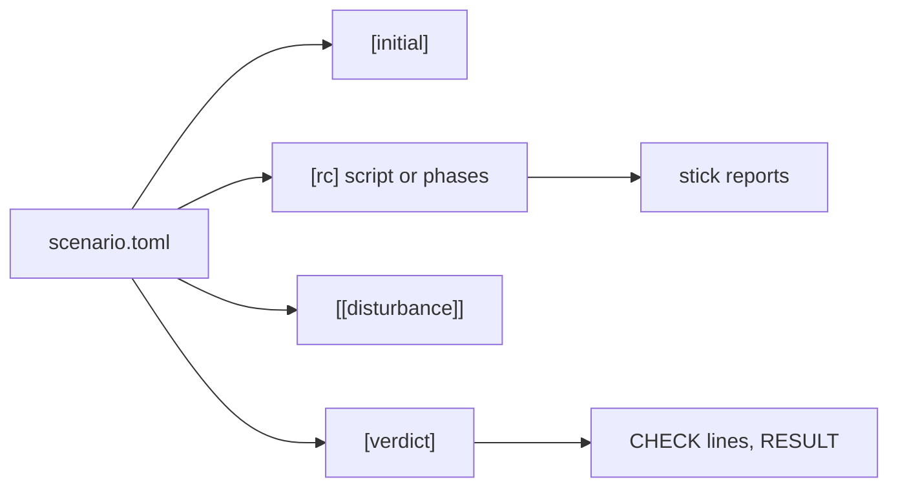

# Scenarios

Part of [MARV-sim](../README.md)

A scenario is a TOML file: the initial state, what the pilot does, disturbances, and a `[verdict]` that names the checks and their
thresholds. Parsing is in `marv-sim/src/scenario.rs`; the checks are in `verdict.rs`. An unknown key is an error in every table and
row, and a file without `[verdict]` does not load. Times are seconds; each script row holds until the next.



## File shape

```toml
[scenario]
name = "hover"
duration_s = 10.0
gnss_rate_hz = 5            # 1, 5 or 10 (default 5)
mag_expected = true         # false leaves MagSample.expected None
gnss_velocity = true        # false leaves GnssReading.vel_ned_mm_s None
baro_lost = [[46.0, 51.5]]  # optional
[initial]                   # position, velocity, roll_pitch_yaw_deg (Z-Y-X), rates, rotors = "hover" | "stopped"
[rc]
script = [ { t_s = 0.0, roll = 0.0, pitch = 0.0, yaw = 0.0, throttle = 0.0, arm = false }, ... ]
lost = [ { from_s = 3.0, to_s = 5.0 } ]     # no report in [from, to)
[[disturbance]]             # body torque from from_s (to to_s if given)
from_s = 5.0
torque_nm = [0.046, 0.0, 0.0]
[verdict]
check = "hover"             # hover | steps | stick_sign | rc_loss | alt_hold | takeoff_land | ...
```

A script row may add `mode = "low"` (Angle, default) | `"middle"` (Altitude) | `"high"` (Position), the channel-6 switch.

## Stick source options

| Key | Meaning |
|---|---|
| `[scenario] rc_source = "receiver"` | Reports are receiver reports at 100/s; `"crsf"` (default) is CRSF at 250/s |
| `mission = true\|false` in `[rc]` rows | Channel 8 (`RcSample.mission`), carries over like `arm` and `mode`, OFF at the start |
| `throttle = <0..1>` in a phase | A fixed stick (0.5 centre), reached at the stick rate limit |
| `lost = [...]`, `lost = true` | Transmitter off; applies to receiver reports judged at each 10 ms report time |
| `thrust_gain`, `station_hb`, `radio_status`, `mission`, `commands`, `resume` | Hands-off and mission scenario fields, see [campaigns](campaigns.md) |

## Basic scenarios

All start level in the air at hover rotor speed unless noted.

| File | What it does and judges |
|---|---|
| `hover.toml` | 10 s, 0.046 N.m roll torque from 5 s; truth tilt, estimate versus truth tilt, heading change, peak tilt, settled tilt |
| `steps.toml` | Roll, pitch (15 deg) and yaw (75 deg/s) steps and returns; 10-90 % rise time and overshoot (estimate for roll and pitch, truth body rate for yaw) |
| `stick-sign.toml` | Short roll, pitch, yaw, throttle pulses; truth must move the right way with little on the other axes |
| `rc-loss.toml` | Arming rules, RC-loss Stop within 2.5 ms of the 1.0 s timeout, no re-arm without a switch cycle, switch-off Stop |
| `alt-hold.toml` | Altitude mode from 0.04 s, hover torque from 12 s, climb stick at 23-24 s, descent at 34-36 s, `baro_lost` 46-51.5 s, 56 s. Run with `--estimator eskf2 --preroll 2.0`. Judges height against target <= 0.5 m, estimate against truth (barometer drift removed) <= 0.3 m, the mode sequence Angle to Altitude and back, and finite, armed |
| `takeoff-land.toml` | Starts on the ground, motors stopped; phases and the sim pilot, below |
| `pos-hold*.toml` | Position-hold variants with wind (`pos-hold-nc.toml`, `pos-hold-ps5.toml`, `pos-hold-spread.toml`, `pos-hold-diag.toml`) |

Negative controls (they must FAIL) are in `scenarios/negative/`; `marv-run --tuning-override <name>=<value>` (for example
`psc_velz_i=0`) is the same idea on the gains.

## Phases and the sim pilot

Instead of `script`, `[rc] phase = [...]` with a `[pilot]` table. Each phase starts when the previous ends: after `after_s`, or at
an `event` (`airborne`: height >= `[pilot] airborne_m`; `below`: height < `below_m`; `landed`: contact since the previous report)
with a `timeout_s`. The run ends with the last phase (`duration_s` is an upper bound). `arm` keeps its value from the previous
phase if not given; `throttle = "zero" | "ramp"`, or `height_m`, or `descend_ms`; `roll`, `pitch`, `yaw` scripted sticks;
`xy = "hold"` turns on the drift correction.

The pilot (`pilot.rs`) is a test device, not flight code. It sees only a `PilotView` (truth height, vertical speed, horizontal
velocity in the heading frame, contact flags, heading) delayed by `delay_s`, and makes one stick report per 4 ms. It never sees the
estimate, never arms or disarms.

| Mode | Behaviour |
|---|---|
| zero | Throttle stick to 0 |
| ramp | Raise the throttle stick from 0 at `ramp_stick_per_s` |
| height / descend | `v_ref = clamp(k_h (h_ref - h), -v_dn, v_up)` or `-descend_ms`; thrust ratio `1 + (clamp(k_v (v_ref - v), +/-accel_max_g g) + I) / g`, `I' = k_i (v_ref - v)`, frozen while the stick is at 0 or 1; at the ramp-to-height switch `I = g (c_lift - 1)` within +/-0.5 g |
| stick map | 0 -> 0, 0.5 -> m g, 1 -> min(`stick_thrust_max_g`, 4 k_F w_max^2 / m g) x m g (2.0: one straight line, the flight code's cap) |
| drift | Roll and pitch sticks `-(xy_k v_h + xy_ki * integral v_h) / g / ANGLE_MAX` (30 deg), at most `xy_stick_max`; the integral is fixed to the ground and frozen at the cap |

Every stick moves at most `stick_rate_per_s`.

## The take-off and landing verdict

`check = "takeoff_land"` judges: Stop before switch-on, armed within 6.5 ms, idle level exactly, stance margin
`tau_xy / (N r_stance)`, tilt for 1 s after lift-off, no re-contact before the first rise through `airborne_m`, a single flight,
peak height and climb speed, time to N >= 0.5 m g after touchdown, no timeout, height band, largest tilt, horizontal speed, angle
between estimated and true down, no allocator flag in flight, the touchdown state, idle level after throttle cut, Stop after
switch-off, and (nominal card) the pilot's mean thrust ratio. Touchdown is the first contact after the first rise through
`airborne_m`.

## Code

`marv-sim/src/scenario.rs`, `pilot.rs`, `verdict.rs`; `marv-sim/tests/althold_verdict.rs` shows the mode-sequence checks failing on
synthetic traces.

## Related

[campaigns](campaigns.md), [estimators](estimators.md), [tools](tools.md), [scenarios folder](../scenarios/README.md)
