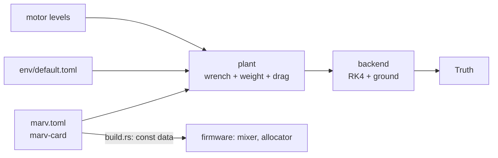

# Vehicle model

Part of [MARV-sim](../README.md)

The vehicle's physical numbers live in one file, the card (`marv-card/marv.toml`); the world's numbers live in the environment
(`env/default.toml`). The plant turns motor levels into a force and torque, the backend integrates them, and an optional ground
plane holds the vehicle until it lifts.

## The card

Every number is a record with a value, a unit, a tag (`measured`, `datasheet`, `cad`, `derived`, `placeholder`, `proposed`) and a
`src`. A `placeholder` needs a range or `range = "ask"`. The `marv-card` build compiles the card into `const` data for the firmware
(`no_std` without feature `std`): rotor positions and spins, mixer matrix, coefficients, levels, mass and the card's sha256.
`marv-run` refuses a card whose sha256 differs from the compiled one. An `"ask"` in a number the firmware needs fails the build;
placeholders show as cargo warnings.

Check it: `cargo run -q -p marv-card --bin card-check -- marv-card/marv.toml env/default.toml` prints `PASS` and exits 0 when every
number has a tag and the card is consistent, then lists open items (placeholders, `"ask"`, `proposed`). Any error exits 1.

Changing it: the block between `# >>> BEGIN GENERATED` and `# <<< END GENERATED` comes from the CAD export (do not edit; the
check notices). Everything else is edited by hand with a tag and a `src` for each number.

## The environment

`env/default.toml`: gravity, ISA atmosphere (sea-level pressure, temperature, lapse rate), origin, magnetic field and wind. The
default origin is a public reference point (Royal Observatory, Greenwich, 51.47783 N, 0.00139 W, 68 m) with the WMM2025 field
there (19.561, 0.434, 45.067 uT NED; declination 1.271 deg, inclination 66.532 deg). The wind defaults to zero.

`--home <file>` runs at a different origin: the file must be the one named by the env's `home_override` (`env/home.local.toml`,
git-ignored), and each record in it replaces the same record of `--env`. A record still `"ask"` that a model needs (today
`origin.altitude`) refuses the run.

## Plant, ground and drag

| Part | Behaviour |
|---|---|
| Plant | Weight, quadratic body drag (`drag.body`), and one linear rotor drag `F_xy = -drag.rotor_linear * va_xy` in body x and y, none in z (`va` = air-relative velocity, body FRD). The card holds rotor drag at 0 (off); range [0, 0.41] N/(m/s) |
| Backend | RK4 integration of the wrench; `NativeBackend::new` has no ground |
| Ground plane | Optional, at down = 0 for the centre of mass (`Start` in `backend.rs`) |
| In GROUND | Position and attitude held, velocity, rates and accelerations 0, so the IMU reads gravity only |
| Lift-off | At the start of a tick when the applied force in NED (weight included) points up; that tick integrates normally |
| Touchdown | At the end of a tick with down >= 0: velocity, tilt and rates from before the hold go to `NativeBackend::touchdown()`, then down, velocity and rates are set to 0, attitude kept for that tick |
| Settle | With `[initial] settle_s` (`with_settle`; 0.08 s in `takeoff-land`) the vehicle then turns at a constant body rate, shown in truth, from the touchdown attitude to the ground plane's roll and pitch, yaw kept; a lift-off during the settle ends it |
| Truth | Carries `on_ground` and `reaction` (normal force, horizontal force, roll/pitch torque: minus the applied wrench) |

No friction, spring or pivot. `[initial] contact = "ground"` starts a scenario held on the ground.

## Code

`marv-card/src/schema.rs` (loader, checks), `marv-card/build.rs` (constants), `marv-sim/src/plant.rs`, `backend.rs`.

## Related

[sensors](sensors.md), [scenarios](scenarios.md), [gazebo](gazebo.md) (the model is generated from the card), [marv-card](../marv-card/README.md), [env](../env/README.md)
